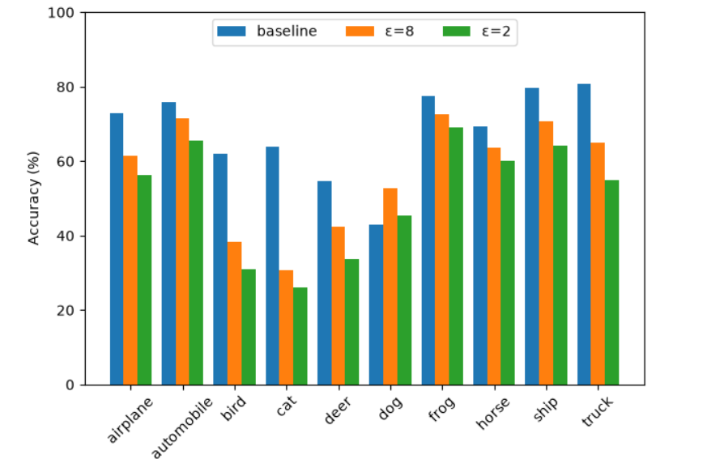
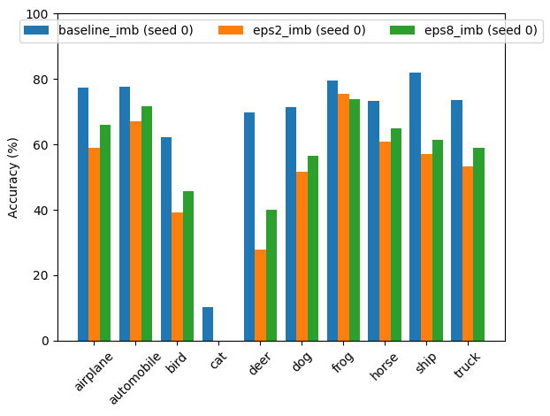

# Per-class accuracy under DP-SGD: a small CIFAR-10 study

A self-directed learning project exploring how differentially private training (DP-SGD) affects **individual classes**, not just overall accuracy, and what happens when one class is **under-represented**.

> **Status:** small exploratory study (single seed, small model). The results below are observations, not general claims.

## Motivation

DP-SGD clips per-sample gradients and adds Gaussian noise. Overall accuracy usually drops, but prior work (e.g. Bagdasaryan et al., 2019) suggests the drop is not spread evenly: under-represented or harder groups can suffer more. I wanted to see this effect myself, in a setting small enough to run on a single GPU.

**Questions**

1. How does per-class accuracy change under DP-SGD at ε = 8 and ε = 2 compared with a non-private baseline?
2. What happens to a class when it is artificially made rare (500 instead of 5,000 training images)?

## Setup

| Item | Value |
|---|---|
| Data | CIFAR-10 (50,000 train / 10,000 test, 1,000 test images per class) |
| Model | ResNet-18, BatchNorm replaced by GroupNorm (`ModuleValidator.fix`) |
| DP library | [Opacus](https://opacus.ai) (`make_private_with_epsilon`, Poisson sampling) |
| Privacy | ε ∈ {8, 2}, δ = 1e-5 (δ < 1/N), noise multiplier σ computed by Opacus |
| Clipping norm C | 1.2 |
| Optimizer / LR | RMSprop, lr = 1e-3 |
| Epochs / batch | 20 epochs, logical batch size 512, max physical batch size 128 (`BatchMemoryManager`) |
| Noise multiplier σ | balanced: 0.646 (ε = 8), 1.162 (ε = 2); imbalanced: 0.657 (ε = 8), 1.201 (ε = 2) |
| Seed | 0 (single run per configuration) |
| Hardware | Balanced runs: laptop with NVIDIA GTX 1070, Intel Core i7 (7th gen), 32 GB RAM. Imbalanced runs: Google Colab, NVIDIA Tesla T4 (≈15 GB) |

**Experiments**

- **Balanced:** the full training set.
- **Imbalanced:** the *cat* class is downsampled to 500 training images (10:1 imbalance ratio, 45,500 training images in total). The test set is untouched.

For each, three models are trained from scratch: a non-private baseline (same architecture and hyperparameters, no clipping or noise), DP with ε = 8, and DP with ε = 2.

## Results

All numbers are test accuracy in %, on the balanced test set.

### Overall and worst-class accuracy

| Training set | Model | Overall | Worst class |
|---|---|---|---|
| Balanced | baseline | 67.99 | dog 42.9 |
| Balanced | ε = 8 | 56.91 | cat 30.6 |
| Balanced | ε = 2 | 50.65 | cat 26.2 |
| Imbalanced (cat: 500) | baseline | 67.73 | cat 10.2 |
| Imbalanced (cat: 500) | ε = 8 | 53.95 | cat 0.0 |
| Imbalanced (cat: 500) | ε = 2 | 49.16 | cat 0.0 |

### Per-class accuracy

| Class | Balanced: baseline | ε = 8 | ε = 2 | Imbalanced: baseline | ε = 8 | ε = 2 |
|---|---|---|---|---|---|---|
| airplane | 72.9 | 61.5 | 56.2 | 77.3 | 66.0 | 58.9 |
| automobile | 75.8 | 71.6 | 65.5 | 77.7 | 71.8 | 67.2 |
| bird | 62.1 | 38.3 | 31.0 | 62.3 | 45.6 | 39.1 |
| **cat** | 64.0 | 30.6 | 26.2 | **10.2** | **0.0** | **0.0** |
| deer | 54.7 | 42.5 | 33.6 | 69.8 | 40.0 | 27.9 |
| dog | 42.9 | 52.7 | 45.5 | 71.4 | 56.5 | 51.7 |
| frog | 77.6 | 72.5 | 69.0 | 79.5 | 74.0 | 75.6 |
| horse | 69.4 | 63.7 | 60.2 | 73.4 | 65.0 | 60.9 |
| ship | 79.8 | 70.7 | 64.3 | 82.0 | 61.5 | 57.0 |
| truck | 80.7 | 65.0 | 55.0 | 73.7 | 59.1 | 53.3 |




## Observations

1. **Overall accuracy hides the rare class.** Without DP, making cat rare leaves overall accuracy essentially unchanged (67.99 → 67.73) while cat accuracy falls from 64.0 to 10.2. The model compensates on the other classes (e.g. dog 42.9 → 71.4).
2. **DP plus rarity collapses the rare class.** With 500 cat images, cat accuracy is 0.0 at both ε = 8 and ε = 2. With the balanced set, the same class keeps 26–31%.
3. **The accuracy drop under DP is uneven across classes.** In the balanced runs (baseline → ε = 2), cat (−37.8), bird (−31.1) and truck (−25.7) lose the most, while horse (−9.2) and automobile (−10.3) lose the least; dog actually gains (+2.6).
4. **Rarity is not the only source of unevenness.** In the imbalanced runs, *deer* (5,000 training images) shows the largest drop among the majority classes (69.8 → 27.9 at ε = 2).

## Hypothesis (not tested here)

A rare class contributes only a handful of examples per batch (about 5–6 cat images per batch at sampling rate ≈ 1%). Its clipped gradient signal is a sum of few terms, while the DP noise added to the batch sum is the same for every class, so the signal-to-noise ratio for that class is low. Testing this would require, for example, measuring the fraction of clipped gradients per class, or sweeping the number of cat images.

## Limitations

- The balanced and imbalanced experiments were run on different machines (laptop GPU vs. Colab T4, possibly different library versions), so small differences between the two sets of baselines are not purely due to the data change.
- Single seed per configuration; differences of a few points between classes should not be over-interpreted. Each per-class number is measured on 1,000 test images.
- One small model (ResNet-18 with GroupNorm) trained from scratch, 20 epochs, without tuning C or the learning rate. DP in practice usually relies on pretrained models and tuned hyperparameters.
- Hyperparameter choices were not tuned on a separate validation set, and no privacy cost was accounted for any tuning.
- Class imbalance on CIFAR-10 is a toy proxy; it is **not** a fairness study over patient subgroups.
- The non-private baseline uses the same architecture and hyperparameters, so the comparison isolates clipping and noise rather than the best achievable non-private accuracy.

## Implementation notes

- **GroupNorm instead of BatchNorm:** BatchNorm mixes information across samples in a batch, which is incompatible with per-sample gradients, so `ModuleValidator.fix` replaces it with GroupNorm.
- **No in-place operations:** with the PyTorch/torchvision/Opacus versions I used, the stock ResNet-18 failed during the DP backward pass because of in-place operations (`ReLU(inplace=True)` and `out += identity` in the residual block). The notebook sets `inplace=False` and overrides the residual block's `forward` with an equivalent version that avoids in-place addition.
- **Poisson sampling:** `make_private_with_epsilon` replaces the data loader with a Poisson-sampling loader, so batch sizes vary slightly; this is required for the privacy accounting to be valid.

## Possible next steps

- Confusion matrices (where do rare-class images go?).
- Multiple seeds with mean ± std.
- Sweep over the number of cat images (e.g. 100 / 500 / 2,000 / 5,000).
- Per-class clipping statistics to test the SNR hypothesis.
- DP finetuning of a pretrained model instead of training from scratch.

## Reproducing

```bash
pip install -r requirements.txt
jupyter notebook dp.ipynb
```

CIFAR-10 is downloaded automatically on first run. A CUDA GPU is recommended (a DP run of 20 epochs is much slower than a non-private run because of per-sample gradients).

## Repository structure

```
.
├── dp.ipynb                     # all code: data, model, DP training, per-class evaluation, plots
├── figures/                     # plots used above
├── requirements.txt
└── README.md
```

## Acknowledgments and references

- The training pipeline is adapted from the official Opacus tutorial *Building an Image Classifier with Differential Privacy* ([opacus.ai/tutorials](https://opacus.ai/tutorials/building_image_classifier)); I extended it with per-class evaluation, a non-private baseline, and the class-imbalance experiment.
- Abadi et al., *Deep Learning with Differential Privacy*, CCS 2016.
- Bagdasaryan et al., *Differential Privacy Has Disparate Impact on Model Accuracy*, NeurIPS 2019.


